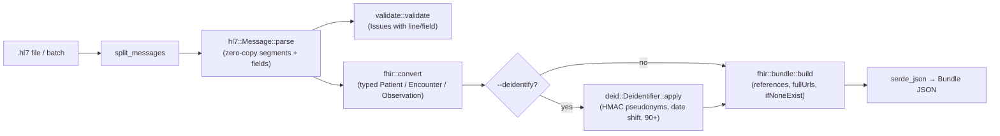

# fhir-bridge

`fhir-bridge` is a Rust library and CLI that parses HL7 v2.x messages and converts ADT^A01/A04/A08 and
ORU^R01 messages into FHIR R4 transaction Bundles (Patient, Encounter, Observation). It can also
de-identify the output in the style of HIPAA Safe Harbor while it converts. The technical core is a
zero-copy parser that borrows `&str` slices from the input. Components, repetitions and sub-components
are split only when they are read, and escape sequences are decoded through a `Cow`, so a value with no
escape character never allocates. The de-identifier is deterministic: a keyed HMAC gives the same
patient the same pseudonym and the same date shift in every message, so de-identified records can
still be linked over time without the mapping being stored anywhere.

> All HL7 data in this repository (fixtures and the benchmark corpus) is **synthetic**. Names such as
> `SAMPLE^ALICE`, IDs such as `TST100001`, SSNs in the never-issued `000-00-xxxx` range and `555-01xx`
> phone numbers are fabricated.

## Features

- **HL7 v2 parser**: segments, fields, components, repetitions and sub-components. It reads the
  delimiters declared in `MSH-1`/`MSH-2` (custom delimiters and the v2.7 truncation character are
  accepted) and accepts CR, LF or CRLF segment terminators, blank lines and a UTF-8 BOM. Batch files
  (`FHS`/`BHS`/`BTS`/`FTS`) are split into messages.
- **Escape sequences**: `\F\ \S\ \R\ \E\ \T\`, `\Xhh..\` hex (UTF-8, falling back to ISO-8859-1) and
  `\.br\`. Highlighting (`\H\`/`\N\`) is stripped and unknown sequences are kept verbatim.
- **Positioned errors**: for example `line 3, segment 3: invalid segment identifier "Pid"`. The
  validator reports issues such as `error: PID-7 (line 2): invalid timestamp "19801345"`.
- **FHIR R4 conversion** to a `transaction` Bundle. Patient and Encounter entries use conditional
  create (`ifNoneExist`). `fullUrl`s are deterministic name-based UUIDs, and LOINC, SNOMED CT and UCUM
  codes are mapped to their canonical system URIs.
- **De-identification** (`--deidentify`):
  - Names, street, city, telecom, email and SSN are removed.
  - MRNs and visit numbers become salted HMAC-SHA256 pseudonyms.
  - Each patient's dates are shifted by a deterministic offset between -365 and +365 days (never 0).
  - Ages over 89 become a `90+` category and the birth date is removed.
  - ZIP codes are cut to 3 digits, and the 17 restricted prefixes become `000`.
  - Free-text results are masked, and provider names and room/bed locations are dropped.
- **CLI**: `convert`, `batch` (a whole directory), `validate` (files or directories, exit code 1 on
  errors) and `generate` (a synthetic corpus).

## Architecture



- **Parse once, split on demand.** `Message::parse` stores one `Vec<&str>` of fields per segment.
  `Field::component`, `repetitions` and `subcomponent` re-slice that field when called. All levels
  share one `Field` type, because splitting a value by a separator it does not contain simply returns
  the value.
- **Typed intermediate model.** The converter does not build `serde_json::Value`. It produces typed
  FHIR structs, so de-identification works on fields such as `patient.birth_date` rather than on JSON
  paths. Dates stay as a `DateTime` type until they are serialized, which makes shifting them exact.
- **Separate stages.** Conversion, de-identification and bundling are separate steps. The bundler
  assigns `fullUrl`s and fills in `subject`/`encounter` references last, so the de-identifier never
  sees or changes references.
- **Warnings instead of failures.** A bad date, a non-numeric `NM` value or an unknown code becomes a
  warning and the rest of the message still converts. Only structural problems are hard errors: an
  unparseable message, an unsupported type or a missing `PID`.
- **Small dependency set.** The project depends on `serde`, `serde_json`, `clap`, `sha2` and `hmac`,
  plus `criterion` for benchmarks. Date arithmetic uses Howard Hinnant's civil-date algorithms, so it
  needs no `chrono`.

### Field mapping

| HL7 v2 | FHIR R4 | Notes |
|---|---|---|
| `MSH-9` | (dispatch) | ADT^A01, ADT^A04, ADT^A08 and ORU^R01 are converted; other types are rejected |
| `MSH-7` | (reference date) | Used for the age-over-89 rule; not emitted |
| `MSH-10` | `Bundle.entry.fullUrl` | Seed for deterministic `urn:uuid` values |
| `PID-3` (CX, repeating) | `Patient.identifier` | `CX.4` HD with ISO OID → `urn:oid:…`, otherwise `urn:fhir-bridge:assigner:<ns>`; `CX.5` → `identifier.type` (v2-0203) |
| `PID-5` (XPN, repeating) | `Patient.name` | family, given + middle, suffix, prefix; type L/D/M/N → official/usual/maiden/nickname |
| `PID-7` | `Patient.birthDate` | Truncated to date precision |
| `PID-8` | `Patient.gender` | M/F/O/U (A, N → other) |
| `PID-11` (XAD, repeating) | `Patient.address` | line, city, state, postalCode, country; type H/B/C → home/work/temp |
| `PID-13`, `PID-14` (XTN) | `Patient.telecom` | Phone/fax/pager/email; PRN/WPN/CP → home/work/mobile |
| `PID-16` | `Patient.maritalStatus` | v2-0002 → v3-MaritalStatus (A→L, P→T) |
| `PID-19` | `Patient.identifier` | System `http://hl7.org/fhir/sid/us-ssn`, type SS |
| `PV1-2` | `Encounter.class` | E/I/O/P → EMER/IMP/AMB/PRENC (v3-ActCode); others kept as v2-0004 |
| `PV1-3` (PL) | `Encounter.location.location.display` | point of care, room, bed |
| `PV1-7`, `PV1-17` (XCN) | `Encounter.participant` | ATND / ADM, display name only |
| `PV1-19` | `Encounter.identifier` | type VN |
| `PV1-44`, `PV1-45` | `Encounter.period.start` / `.end` | `status` = `finished` if PV1-45 is valued, else `in-progress` |
| `OBR-7` | `Observation.effectiveDateTime` | Fallback when `OBX-14` is empty |
| `OBX-2` + `OBX-5` | `Observation.value[x]` | NM → valueQuantity; SN → valueQuantity with comparator (or string for ranges/ratios); CE/CWE/CNE → valueCodeableConcept; others → valueString |
| `OBX-3` (CE/CWE) | `Observation.code` | Primary and alternate coding; `LN` → `http://loinc.org`, `SCT` → SNOMED CT |
| `OBX-6` | `Quantity.unit/code/system` | `UCUM` → `http://unitsofmeasure.org`; otherwise unit text only |
| `OBX-7` | `Observation.referenceRange` | `a-b`, `<b`, `>a` parsed to low/high; anything else → text |
| `OBX-8` | `Observation.interpretation` | v3-ObservationInterpretation (H, L, HH, LL, N, A, AA, …) |
| `OBX-11` | `Observation.status` | F/C/P/R/S/I/X/D/W → final/corrected/preliminary/registered/cancelled/entered-in-error |
| `OBX-14` | `Observation.effectiveDateTime` | |
| message type ORU | `Observation.category` | `laboratory` |

Timestamps that have a time but no UTC offset get the `--tz` offset, which defaults to `Z`. FHIR
requires an offset whenever a time is present.

## Quickstart

You need stable Rust. Run all commands from the repository root:

```sh
cargo build --release
./target/release/fhir-bridge convert tests/fixtures/oru_r01_cbc.hl7            # pretty Bundle JSON on stdout
./target/release/fhir-bridge convert in.hl7 --deidentify --salt "$SECRET" -o out.json
FHIR_BRIDGE_SALT=... ./target/release/fhir-bridge batch hl7_dir --out-dir json_dir --deidentify
./target/release/fhir-bridge validate tests/fixtures
```

This is real output. The input is `tests/fixtures/adt_a01_elderly.hl7`, a 95-year-old synthetic
patient:

```
MSH|^~\&|FAKE_EHR|TEST_HOSPITAL|FHIR_BRIDGE|TEST|20260720101500-0700||ADT^A01^ADT_A01|ADT0006|P|2.5.1
PID|1||TST100006^^^TESTHOSP^MR||ELDERTEST^EDNA||19310203|F|||77 Example Lane^^Sampleton^ZZ^82101^USA^H||||||||000-00-0006
PV1|1|I|2N^220^A||||90005^CARER^CARL|||MED|||||||||V0000006|||||||||||||||||||||||||20260720100000-0700
```

`fhir-bridge convert tests/fixtures/adt_a01_elderly.hl7 --deidentify --salt demo-salt` prints the
following (the Encounter's `identifier` and `class` are omitted here for brevity):

```json
{
  "resourceType": "Bundle",
  "type": "transaction",
  "entry": [
    {
      "fullUrl": "urn:uuid:c7b8d00a-f992-5ed6-b678-9c302b5e676d",
      "resource": {
        "resourceType": "Patient",
        "extension": [{ "url": "urn:fhir-bridge:age-category", "valueString": "90+" }],
        "identifier": [{
          "type": { "coding": [{ "system": "http://terminology.hl7.org/CodeSystem/v2-0203", "code": "MR" }] },
          "system": "urn:fhir-bridge:pseudonym",
          "value": "4a322c6cdf8aba03"
        }],
        "gender": "female",
        "address": [{ "state": "ZZ", "postalCode": "000", "country": "USA" }]
      },
      "request": { "method": "POST", "url": "Patient", "ifNoneExist": "identifier=urn:fhir-bridge:pseudonym|4a322c6cdf8aba03" }
    },
    {
      "fullUrl": "urn:uuid:5834a50e-b6ec-5b97-8553-2a5611949f6d",
      "resource": {
        "resourceType": "Encounter",
        "status": "in-progress",
        "subject": { "reference": "urn:uuid:c7b8d00a-f992-5ed6-b678-9c302b5e676d" },
        "period": { "start": "2026-04-28T10:00:00-07:00" }
      },
      "request": { "method": "POST", "url": "Encounter", "ifNoneExist": "identifier=urn:fhir-bridge:pseudonym|9ce9276cff32ec0b" }
    }
  ]
}
```

In this output the SSN, name, address line and city are gone. The ZIP prefix `821` is on the
restricted list, so it is reported as `000`. The birth date is replaced by `90+`. The admission date
has moved by this patient's offset (-83 days for this salt), and the attending physician and bed are
dropped.

`fhir-bridge validate` output:

```
INVALID tests/fixtures/invalid_semantics.hl7
  message 1: error: MSH-10 (line 1): message control ID is required
  message 1: error: PID-3 (line 2): patient identifier is required
  message 1: error: PID-7 (line 2): invalid timestamp "19801345"
  message 1: error: OBX-5 (line 3): "pending" is not a valid NM value
INVALID tests/fixtures/malformed_bad_segment_id.hl7
  message 1: error: line 3, segment 3: invalid segment identifier "Pid"
OK tests/fixtures/oru_r01_cbc.hl7
3 file(s) checked, 2 invalid
```

As a library:

```rust
use fhir_bridge::{deid::Deidentifier, fhir, hl7::Message};

let message = Message::parse(text)?;
let pid = message.segment("PID").unwrap();
let family = pid.field(5).component(1).value();          // Cow<str>, escape-decoded
let deid = Deidentifier::new("secret-salt")?;
let (bundle, warnings) = fhir::message_to_bundle(&message, &Default::default(), Some(&deid))?;
```

## Results

The commands below generate a synthetic corpus, benchmark it with criterion and write
[`bench/RESULTS.md`](bench/RESULTS.md):

```sh
cargo bench --bench throughput
cargo run --release --example bench_report
```

- **Dataset:** 1,000 synthetic messages from `synth::messages(seed = 42)`, 607,981 bytes. The mix is
  ADT^A01/A04/A08 and ORU^R01, with 3-8 LOINC-coded OBX results per ORU.
- **Machine:** 12th Gen Intel Core i7-12700, Windows 11, rustc 1.99.1 (`x86_64-pc-windows-gnu`),
  default release profile.
- **Date measured:** 2026-11-06.

| Benchmark | Mean time / corpus | 95% CI of mean | Messages/sec | MB/s |
|---|---:|---:|---:|---:|
| Parse only | 2.23 ms | 2.20 - 2.26 ms | 448,408 | 272.6 |
| Parse + convert + serialize JSON | 18.15 ms | 17.96 - 18.35 ms | 55,103 | 33.5 |
| Parse + convert + de-identify + serialize JSON | 18.84 ms | 18.60 - 19.12 ms | 53,065 | 32.3 |

Each timing covers a whole pass over the corpus on a single thread. Conversion costs much more than
parsing. That is expected: parsing only slices the input, while conversion allocates owned FHIR
strings and serializes about 3.3 MB of JSON per corpus. De-identification adds about 4% in this run,
mostly from HMAC-SHA256: one per identifier for its pseudonym and one per patient for the date shift.

The machine is a shared desktop, so treat these as indicative numbers. The table is the last of four
runs. The run just before it, on the same code, was within criterion's noise threshold for parse and
parse+convert and 11% slower for the de-identify path. Two earlier runs were on slightly older code
and give a sense of the spread on this machine:

- Before the `Observation` enum variant was boxed: parse 3.5 ms and parse+convert 20.5 ms per corpus.
- Under heavier background load and before a hex-encoding allocation fix: parse 4.8 ms and
  parse+convert 56 ms per corpus.

## Tests / CI

```sh
cargo test          # 59 tests: 31 unit, 19 fixture-based integration, 8 CLI, 1 doc test
```

`tests/fixtures/` holds 19 synthetic messages:

- ADT A01/A04/A08 messages covering inpatient, outpatient, discharged and elderly patients
- repetitions and escape sequences
- LF and CRLF line endings, custom delimiters and an FHS/BHS batch file
- three ORU^R01 lab panels
- four malformed messages: missing MSH, bad segment ID, duplicate encoding characters and a
  truncated MSH
- one semantically invalid message and one unsupported SIU^S12

The integration tests check the field mapping and that every reference resolves inside its Bundle.
For de-identification they check that:

- de-identified JSON contains none of 15 known PHI strings
- pseudonyms and date shifts stay stable across messages for the same patient
- date shifts keep the intervals between events
- the 90+ rule and the ZIP rules are applied

GitHub Actions (`.github/workflows/ci.yml`) runs `cargo fmt --check`,
`cargo clippy --all-targets -- -D warnings` and `cargo test --all-targets` on ubuntu-latest with
stable Rust.

## Limitations and next steps

- **Safe Harbor coverage is partial.** This is *Safe Harbor-style*, not a certified de-identification.
  - Safe Harbor itself requires removing all date elements except the year. Date shifting is a
    common alternative, but strictly it belongs to Expert Determination.
  - Keyed-hash pseudonyms are derived from the identifier. Safe Harbor's re-identification code
    provision expects codes that are not derived from PHI.
  - Free-text values are masked, not scrubbed, and `NTE` segments are not converted at all.
  - The restricted ZIP3 list comes from HHS guidance based on the 2000 Census.
  - Review with your privacy office before using this on real data.
- **Conversion covers a subset.**
  - Only 4 trigger events are converted, and only the fields in the table above.
  - There is no DiagnosticReport for ORU, and no `NK1`, `AL1`, `DG1`, `IN1` or `ORC` mapping.
  - Local code systems (anything other than LN, SCT and UCUM) are emitted without a `system`.
- **Value fidelity is limited.**
  - Fractional seconds are dropped.
  - FHIR decimals are emitted as `f64`, so `4.10` becomes `4.1`.
  - `DTM` values without an offset are assumed to use the `--tz` offset.
- **Validation is light.** The validator checks required fields and data types for the segments it
  converts. It is not a conformance-profile validator.
- **Not run locally:** `cargo clippy` could not be run on the development machine. Only the
  `x86_64-pc-windows-gnu` toolchain can link there, and it has no clippy component. CI runs clippy
  on Linux.
  - Also for this machine only, some Windows-only transitive dependencies (`windows-sys` users) are
    pinned in `Cargo.lock` to versions that do not need `dlltool`. They have no effect on Linux.
- **Next steps:** an optional HTTP endpoint, DiagnosticReport generation, streaming conversion of large
  batch files in parallel, and output checks against the official FHIR validator.

## License

MIT. Copyright (c) 2026 Bryant Le.
